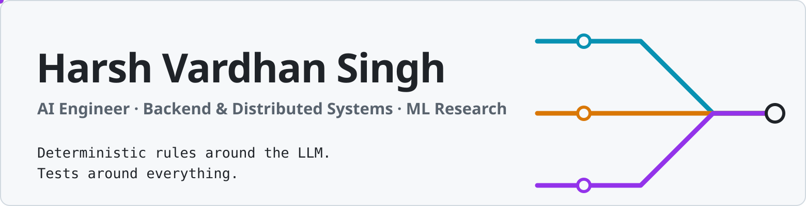
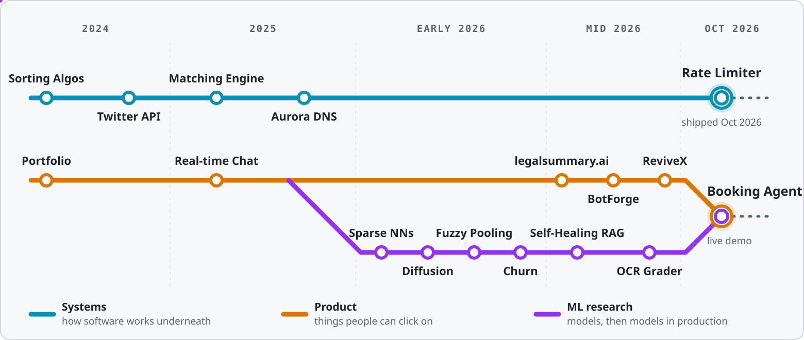
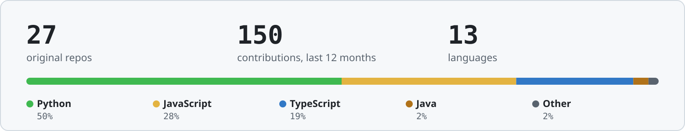

<picture>
  <source media="(prefers-color-scheme: dark)" srcset="assets/hero-dark.svg"/>
  
</picture>

  
  
  

<!-- Add contact links here, e.g.:

  
  

-->

I like the part of engineering where an idea becomes something real people can click on. Lately that means **AI agents with guardrails**: systems where the model reasons, but plain code enforces the rules, audits the output, and keeps things running when a dependency falls over.

**Short on time?** Jump to [the four projects to open first](#the-four-projects-to-open-first), or try a live demo: [Booking Agent](https://booking-agent-lemon.vercel.app) · [ReviveX](https://revive-x-ochre.vercel.app/)

---

## The journey so far

Three lines of work that started separately and are now converging. Read it left to right, then open any chapter for the code.

<picture>
  <source media="(prefers-color-scheme: dark)" srcset="assets/journey-dark.svg"/>
  
</picture>

<b>Chapter 1 · 2024: Learning the fundamentals</b>

 

Algorithms in five languages, a first portfolio, a first backend.

- **[sorting-algorithms](https://github.com/harshsuiiii/sorting-algorithms)**: classic sorts written in C, C++, Java, Python and JavaScript.
- **[twitter-backend](https://github.com/harshsuiiii/twitter-backend-project-deployment)**: a REST API replicating Twitter's core: tweets, likes, followers and full CRUD.
- **[portfolio](https://github.com/harshsuiiii/portfolio)**: where it all started.

<b>Chapter 2 · 2025: Real-time and low-level</b>

 

Websockets and auth, then my first look at what happens below the framework.

- **[Real-time Chat](https://github.com/harshsuiiii/Real-time-chat-app)**: MERN and Socket.io chat with JWT auth, online presence and Zustand state.
- **[Matching Engine](https://github.com/harshsuiiii/LOW-LATENCY-TRADING-MATCHING-ENGINE-ORDERBOOK-)**: an exchange-style order book in TypeScript with price-time priority matching, market depth, and VWAP and mid-price quotes.
- **[Aurora DNS](https://github.com/harshsuiiii/aurora-DNS)**: a DNS server from scratch. Parses RFC 1035 packets from raw buffers, with TTL caching, upstream failover and a Pi-hole-style ad blocker.

<b>Chapter 3 · Early 2026: Into ML research</b>

 

ML4SCI evaluation tasks for GSoC 2026 on CERN CMS detector data, plus applied deep-learning studies.

- **[Sparse NNs for CMS Jets](https://github.com/harshsuiiii/ML4SCI-Task-2d-Sparse-Neural-Networks-for-End-to-End-Event-Classification)**: a sparsity-aware ResNet that beats a dense CNN baseline by **+6.2 pp accuracy and +6.0 pp AUC** (87.5% and 0.933), then holds up under L1 pruning.
- **[Diffusion vs GAN vs VAE](https://github.com/harshsuiiii/ML4SCI-Diffusion-Models-for-Task-2e-Generative-Modelling-with-Diffusion-GAN-and-VAE)**: three generative models trained on sparse, heavy-tailed CMS jet images and compared with statistical tests.
- **[Fuzzy Pooling](https://github.com/harshsuiiii/Fuzzy_Neural_Network)**: ten CNN pooling strategies evaluated for Bitcoin price prediction, including four novel ones. Adaptive Attention Pooling came out on top.
- **[Customer Churn](https://github.com/harshsuiiii/customer_churn_prediction)**: a class-imbalance study comparing neural nets and tree ensembles, tuned for recall on churners.

<b>Chapter 4 · Mid 2026: Putting LLMs inside real products</b>

 

Grounding, compliance and privacy treated as features, not afterthoughts.

- **[Self-Healing RAG](https://github.com/harshsuiiii/Self-healing-RAG)**: a LangGraph pipeline where a critic audits every answer claim by claim. Ungrounded answers trigger bounded query reformulation, then an honest fallback.
- **[legalsummary.ai](https://github.com/harshsuiiii/legalsummary.ai)**: plain-language summaries and clause analysis of legal documents on Next.js and Google Cloud, with PII redaction through Cloud DLP.
- **[OCR Semantic Grader](https://github.com/harshsuiiii/OCR-Semantic-Grader)**: TrOCR reads handwritten answers, Sentence-BERT scores them against model answers, and an agent re-checks borderline cases.
- **[BotForge](https://github.com/harshsuiiii/botforge-saas)**: multi-tenant SaaS to create, embed and monitor AI chatbots, with Google OAuth, AES-256-GCM token encryption, an SSE streaming widget and session analytics.
- **[ReviveX](https://github.com/harshsuiiii/ReviveX)**: a payment-recovery agent on Razorpay's APIs that works out *why* a payment failed and escalates retries under deterministic compliance rules. [Live demo](https://revive-x-ochre.vercel.app/)
- **[NetrAI / PrivAgent](https://github.com/chotushikari/NetrAI)** *(team project)*: a privacy-preserving browser agent that redacts PII on-device before anything reaches the AI.

<b>Chapter 5 · Now: Production-grade systems</b>

 

Typed, tested, observable, and designed to survive failure.

- **[Booking Agent](https://github.com/harshsuiiii/Booking-Agent)**: natural-language flight search for travel agents, with parallel multi-supplier search, normalised offers and human-confirmed booking. [Live demo](https://booking-agent-lemon.vercel.app)
- **[Distributed Rate Limiter](https://github.com/harshsuiiii/rate-limiter)**: one shared limit across N servers using atomic Redis Lua scripts, with four algorithms and a circuit breaker with local fallback when Redis degrades.

---

## The four projects to open first

<table>
<tr>
<td width="50%" valign="top">

### [Booking Agent](https://github.com/harshsuiiii/Booking-Agent)
Describe a trip in plain language. It searches several suppliers in parallel, normalises every result into one offer format, and prices it in INR with the agency's markup. Booking stays a separate, human-confirmed step.

**Engineering:** strict mypy, property-based tests with Hypothesis, Playwright for the web app, OpenTelemetry tracing.

   

[**Live demo →**](https://booking-agent-lemon.vercel.app) Uses simulated and sandbox fares.

</td>
<td width="50%" valign="top">

### [Distributed Rate Limiter](https://github.com/harshsuiiii/rate-limiter)
Every decision is one atomic Lua script, timed by the Redis clock, so replicas can't disagree and clock drift can't change limits. It stays up when Redis is slow or down.

**Proof:** 8 connections race 600 requests at a limit of 100, and exactly 100 are admitted for every algorithm.

   

</td>
</tr>
<tr>
<td width="50%" valign="top">

### [ReviveX](https://github.com/harshsuiiii/ReviveX)
An AI agent for recovering failed payments. Gemini writes the message and the reasoning; plain TypeScript enforces the limits: 3 attempts at most, quiet hours from 21:00 to 08:00 IST, and a 60-minute gap between tries.

  

[**Live demo →**](https://revive-x-ochre.vercel.app/)

</td>
<td width="50%" valign="top">

### [Sparse NNs for CMS Jets](https://github.com/harshsuiiii/ML4SCI-Task-2d-Sparse-Neural-Networks-for-End-to-End-Event-Classification)
A physics-motivated network for CERN detector data, where most cells record zero energy. It masks those empty cells so it learns only from real signal.

**Result:** 87.5% accuracy and 0.933 AUC, **+6.2 pp** and **+6.0 pp** over the dense baseline.

  

</td>
</tr>
</table>

---

## Toolbox

Grouped by how recently I've shipped with it. Everything here appears in a repo above.

<table>
<tr><td width="24%"><b>Shipping with now</b></td><td>

 
  

</td></tr>
<tr><td><b>AI &amp; ML</b></td><td>

 
    

</td></tr>
<tr><td><b>Built with before</b></td><td>

 
 

</td></tr>
</table>

---

## On GitHub right now

<picture>
  <source media="(prefers-color-scheme: dark)" srcset="assets/stats-dark.svg"/>
  
</picture>

**Latest pushes**

<!--START_SECTION:pushes-->
- `2026-11-07` **[Auto-Redteaming-Agent](https://github.com/harshsuiiii/Auto-Redteaming-Agent)**
- `2026-10-30` **[rate-limiter](https://github.com/harshsuiiii/rate-limiter)** — One shared limit across N servers, built on atomic Redis Lua scripts
- `2026-10-26` **[botforge-saas](https://github.com/harshsuiiii/botforge-saas)** — Multi-tenant SaaS to create, embed and monitor AI chatbots
- `2026-10-20` **[Booking-Agent](https://github.com/harshsuiiii/Booking-Agent)** — Natural-language flight search for travel agents
- `2026-08-30` **[ReviveX](https://github.com/harshsuiiii/ReviveX)** — AI payment-recovery agent with deterministic compliance rules
<!--END_SECTION:pushes-->

<picture>
  <source media="(prefers-color-scheme: dark)" srcset="https://raw.githubusercontent.com/harshsuiiii/harshsuiiii/output/github-snake-dark.svg"/>
  
</picture>

Stats and pushes refresh daily through <a href=".github/workflows/profile.yml">a GitHub Action in this repo</a>. Languages exclude forks and notebook files.

---

<b>Open to SDE and AI-engineering internships, and research collaborations.</b> If something here caught your eye, let's talk.

